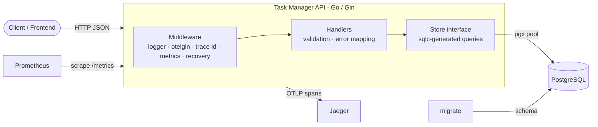

# Task Manager Service

A small backend service for managing to-do tasks, exposed as a RESTful JSON API.
Built with **Go**, **Gin**, **PostgreSQL**, **sqlc**, and instrumented with **Prometheus** metrics and **OpenTelemetry** tracing.

- CRUD for tasks, with pagination and filtering by `status` and `assignee`
- Test-driven: unit tests (gomock) + integration tests (real Postgres) — **77% coverage**
- One-command startup with Docker Compose (multi-stage image, ~13 MB)
- OpenAPI (Swagger 2.0) spec and interactive docs
- Observability: Prometheus metrics, Jaeger traces, trace id on every response

---

## Table of contents

1. [Quick start](#quick-start)
2. [API](#api)
3. [curl examples](#curl-examples)
4. [Running tests](#running-tests)
5. [Local development](#local-development)
6. [Configuration](#configuration)
7. [Observability](#observability)
8. [Architecture](#architecture)
9. [Design decisions and trade-offs](#design-decisions-and-trade-offs)
10. [Not implemented / future work](#not-implemented--future-work)

---

## Quick start

Requirements: **Docker** with Docker Compose v2.

```bash
git clone https://github.com/fatemeMohammadi071/task-manager.git
cd task-manager
docker compose up --build
```

Compose starts the services in order: `postgres` (healthy) → `migrate` (applies the schema, then exits) → `api`.

| Service | URL |
|---|---|
| API | http://localhost:8080 |
| Swagger UI | http://localhost:8080/swagger/index.html |
| Health check | http://localhost:8080/health |
| Metrics | http://localhost:8080/metrics |
| Prometheus | http://localhost:9090 |
| Jaeger (traces) | http://localhost:16686 |

Stop everything with `docker compose down` (add `-v` to also delete the database volume).

---

## API

Base path: `/api/v1`. All requests and responses use JSON.
Full specification: [`docs/swagger.yaml`](docs/swagger.yaml) / [`docs/swagger.json`](docs/swagger.json), or the Swagger UI above.

| Method | Path | Description | Success |
|---|---|---|---|
| `POST` | `/api/v1/tasks` | Create a task | `201` + task |
| `GET` | `/api/v1/tasks` | List tasks (paginated, filterable) | `200` + list |
| `GET` | `/api/v1/tasks/{id}` | Get one task | `200` + task |
| `PATCH` | `/api/v1/tasks/{id}` | Partially update a task | `200` + task |
| `DELETE` | `/api/v1/tasks/{id}` | Delete a task | `204`, no body |
| `GET` | `/health` | Liveness check | `200` |
| `GET` | `/metrics` | Prometheus metrics | `200` |

### Task object

```json
{
  "id": 42,
  "title": "Write README",
  "description": "setup + curl examples",
  "status": "in_progress",
  "assignee": "fateme",
  "created_at": "2026-10-18T15:26:48.051039Z",
  "updated_at": "2026-10-18T17:09:55.55503Z"
}
```

| Field | Type | Rules |
|---|---|---|
| `title` | string | required on create, 1–255 chars |
| `description` | string | optional, max 5000 chars, defaults to `""` |
| `status` | string | one of `todo`, `in_progress`, `done`; defaults to `todo` |
| `assignee` | string \| null | optional, max 100 chars |

### Create — `POST /api/v1/tasks`

Request:

```json
{ "title": "Write README", "description": "setup + curl examples", "status": "todo", "assignee": "fateme" }
```

Only `title` is required.

### List — `GET /api/v1/tasks`

| Query param | Default | Rules |
|---|---|---|
| `page_id` | `1` | ≥ 1 |
| `page_size` | `10` | 1–100 |
| `status` | — | `todo`, `in_progress` or `done` |
| `assignee` | — | exact match |

Response:

```json
{
  "data": [ { "id": 18, "title": "Write README", "status": "done", "...": "..." } ],
  "total": 1,
  "page_id": 1,
  "page_size": 10
}
```

`total` is the number of tasks matching the filters (across all pages), so clients can render pagination.

### Update — `PATCH /api/v1/tasks/{id}`

Only the fields that are sent are changed; at least one field is required.

```json
{ "status": "done" }
```

### Errors

Every error has the same shape:

```json
{ "error": "task not found" }
```

| Status | When |
|---|---|
| `400` | Invalid id, invalid body or query parameters, empty `PATCH` body |
| `404` | Task does not exist |
| `500` | Unexpected server error — the client gets a generic message; details are logged with the trace id |

---

## curl examples

```bash
# Create
curl -s -X POST http://localhost:8080/api/v1/tasks \
  -H "Content-Type: application/json" \
  -d '{"title":"Write README","description":"setup + curl examples","assignee":"fateme"}'

# List (defaults: page 1, size 10)
curl -s "http://localhost:8080/api/v1/tasks"

# List with pagination and filters
curl -s "http://localhost:8080/api/v1/tasks?status=in_progress&assignee=fateme&page_id=1&page_size=5"

# Get by id
curl -s http://localhost:8080/api/v1/tasks/1

# Update only the status
curl -s -X PATCH http://localhost:8080/api/v1/tasks/1 \
  -H "Content-Type: application/json" \
  -d '{"status":"done"}'

# Delete (204), deleting again returns 404
curl -i -X DELETE http://localhost:8080/api/v1/tasks/1

# Validation error (400)
curl -i -X POST http://localhost:8080/api/v1/tasks \
  -H "Content-Type: application/json" \
  -d '{"title":"x","status":"blocked"}'
```

Every response includes an `X-Trace-Id` header that can be pasted into Jaeger to find that exact request.

---

## Running tests

The integration tests need a running Postgres with the schema applied:

```bash
make up          # start Postgres only
make migrateup   # apply migrations (first time only)
make test        # all tests, with the race detector
make cover-check # combined coverage report; fails below 70%
```

`make cover` also writes `coverage.html` (open it in a browser to see covered lines).

### Testing strategy

| Layer | Type | How |
|---|---|---|
| `internal/db/sqlc` | **Integration** | Real Postgres; every query (CRUD, filters, pagination, count, partial update, not-found) |
| `internal/api` | **Unit** | Handlers tested with a **gomock** `Store` — success, validation (400), not found (404), DB errors (500), and that invalid input never reaches the DB |
| `internal/observability` | Unit | Metric labels (route template, unmatched routes, panics counted as 500), registry isolation, in-memory span recorder for tracing |
| `util` | Unit | Config from file, env override, and env-only (no file, as in Docker) |

The API endpoints were developed **test-first**: the git history contains a failing `test(...)` commit before each `feat(...)` commit.

**Coverage: 77.3%** of statements across all packages, measured with `-coverpkg` so every test counts against every package. Only generated code is excluded (`internal/db/mock`, `docs`). `cmd/server/main.go` is included (it is wiring code and is exercised by the Docker Compose run).

---

## Local development

Requirements: Go 1.26+, Docker, and the CLIs `sqlc`, `migrate`, `mockgen`, `swag`.

```bash
make up          # Postgres in Docker
make migrateup
make server      # runs the API on :8080 with config from app.env
```

| Make target | What it does |
|---|---|
| `up` / `down` | Start Postgres only / stop all containers |
| `psql` | Open a psql shell in the database |
| `new_migration name=<x>` | Create a new migration pair |
| `migrateup` / `migratedown` | Apply / roll back all migrations |
| `sqlc` | Regenerate Go code from `internal/db/query/*.sql` |
| `mock` | Regenerate the gomock `Store` mock |
| `swagger` | Regenerate `docs/swagger.{json,yaml}` from handler annotations |
| `server` | Run the API locally |
| `test` / `cover` / `cover-check` | Tests / coverage report / coverage gate (≥ 70%) |
| `compose-up` / `compose-build` / `compose-down` / `compose-logs` | Full stack in Docker |

---

## Configuration

Configuration is read from `app.env` and can be overridden by environment variables (Docker uses environment variables only; `app.env` is excluded from the image).

| Variable | Default | Description |
|---|---|---|
| `ENVIRONMENT` | `development` | `production` switches Gin to release mode |
| `DB_SOURCE` | — | Postgres connection URL |
| `HTTP_SERVER_ADDRESS` | `0.0.0.0:8080` | Listen address |
| `TRACING_ENDPOINT` | empty | OTLP/HTTP endpoint (e.g. `jaeger:4318`); empty disables tracing |

`app.env` contains only local development values and no real secrets.

---

## Observability

### Metrics (Prometheus)

Exposed at `GET /metrics`, scraped by the Prometheus container every 15 s.

| Metric | Type | Labels | Description |
|---|---|---|---|
| `requests_total` | counter | `method`, `path`, `status` | Number of HTTP requests |
| `request_latency_seconds` | histogram | `method`, `path` | Request latency histogram (the requested `request_latency_histogram`; named with its unit, per Prometheus conventions) |
| `tasks_count` | gauge | — | Current number of tasks |

Plus standard Go runtime and process metrics (`go_goroutines`, memory, GC, CPU).

- `path` is the **route template** (`/api/v1/tasks/:id`), not the raw URL, so the number of series stays bounded; unknown routes share the label `unmatched`.
- The metrics middleware runs outside the panic-recovery middleware, so panics are counted as `500`.
- `tasks_count` is initialised from the database at startup and updated on create/delete.

Example PromQL queries (http://localhost:9090):

```promql
tasks_count
rate(requests_total[1m])
histogram_quantile(0.95, sum by (le, path) (rate(request_latency_seconds_bucket[5m])))
```

### Tracing (OpenTelemetry + Jaeger)

- `otelgin` creates one span per HTTP request (named by route template); `/health` and `/metrics` are skipped.
- `otelpgx` creates a child span for every SQL query, so a trace shows the request and its database calls together.
- Spans are exported over OTLP/HTTP to Jaeger in batches; buffered spans are flushed on shutdown.
- The W3C `traceparent` header is propagated, so the service can join traces started by other services.
- Every response carries `X-Trace-Id`; 500 errors are recorded on the span and logged with the trace id.

Open http://localhost:16686, choose service **task-manager** and click **Find Traces**.

<!-- Optional: add a screenshot of a trace -->
<!--  -->

---

## Architecture



### Request flow

1. **Middleware** — logging, tracing span, `X-Trace-Id`, metrics, panic recovery.
2. **Handler** — binds and validates the request (Gin binding tags), applies defaults, calls the store, maps errors to HTTP status codes.
3. **Store** — an interface over the sqlc-generated `Querier`; the real implementation uses a `pgxpool`, tests use a gomock mock.
4. **PostgreSQL** — the single source of truth.

### Project structure

```
cmd/server/            main: config, DB pool, tracer, metrics, HTTP server, graceful shutdown
internal/api/          Gin server, routes, handlers, request/response types, handler tests
internal/db/migration/ SQL migrations (golang-migrate)
internal/db/query/     SQL queries (input for sqlc)
internal/db/sqlc/      generated query code + Store interface + integration tests
internal/db/mock/      generated gomock Store
internal/observability/ Prometheus metrics middleware, OpenTelemetry setup
util/                  config loading (Viper), random test data
docs/                  generated OpenAPI spec (swagger.json / swagger.yaml)
deploy/                Prometheus config
```

### Data model

```sql
CREATE TYPE task_status AS ENUM ('todo', 'in_progress', 'done');

CREATE TABLE tasks (
  id          BIGSERIAL PRIMARY KEY,
  title       VARCHAR(255) NOT NULL,
  description TEXT         NOT NULL DEFAULT '',
  status      task_status  NOT NULL DEFAULT 'todo',
  assignee    VARCHAR(100),
  created_at  TIMESTAMPTZ  NOT NULL DEFAULT now(),
  updated_at  TIMESTAMPTZ  NOT NULL DEFAULT now()
);
-- indexes on status and assignee (the filter columns)
```

---

## Design decisions and trade-offs

**Data access**

- **sqlc instead of an ORM** — SQL is written by hand and compiled into type-safe Go; no reflection or hidden queries. The cost is one code-generation step.
- **pgx/v5 instead of lib/pq** — actively maintained, Postgres-native driver; nullable columns map to `*string` (clean JSON `null`) instead of `sql.NullString`. `lib/pq` is in maintenance mode.
- **Postgres `ENUM` for status** — the database rejects invalid values and sqlc generates Go constants. Adding a status requires a migration.
- **One query for every filter combination** — optional filters use `sqlc.narg(...) IS NULL OR column = ...`, so there is no dynamic SQL string building.

**API**

- **`PATCH` instead of `PUT`** — the update query uses `COALESCE(new, old)`, so only sent fields change. Limitation: a client cannot set `assignee` back to `null` with this endpoint.
- **Offset pagination** — simple for clients. On very large tables, or when rows change between pages, cursor pagination (`WHERE id > last_id`) would be faster and more stable.
- **List response envelope** (`data`, `total`, `page_id`, `page_size`) — clients can render pagination, and fields can be added without breaking them.
- **List + count are two queries** — not atomic, so `total` may be off by one during concurrent writes; acceptable for this use case. `COUNT(*) OVER()` would combine them.
- **Delete uses `:execrows`** — 0 affected rows means 404, without an extra `SELECT`.
- **Internal errors are not leaked** — clients get `"internal server error"`; the real error is logged with the trace id.

**Operations**

- **Migrations run in a separate `migrate` container** — the API image contains only the binary. Alternative: embed migrations in the binary and run them on startup (self-contained, but adds startup logic and can race with multiple replicas).
- **Multi-stage Docker build, non-root user** — final image is about 13 MB with no compiler or source code.
- **Graceful shutdown** — on `SIGTERM` the server stops accepting connections, gives in-flight requests up to 10 s, then flushes traces.
- **`tasks_count` as an in-memory gauge** — set from the DB at startup and updated with Inc/Dec. Exact for one instance; with several replicas, a `GaugeFunc` running `COUNT(*)` on scrape (or a DB exporter) would be needed.
- **`/metrics` on the public port** — fine for this task; in production it should be on an internal port or protected by the network.
- **Config file committed** — `app.env` has only local development values. In production, secrets would come from environment variables or a secret manager.
- **Integration tests use the development database** — simple, but test rows accumulate. A separate test database, or cleanup per test, would isolate them.

---

## Not implemented / future work

These optional items from the assignment were not implemented in the available time:

- **Redis cache for `GET /tasks` (cache-aside)** — planned design: cache the serialised list response per normalised query, with a short TTL. Include a version number in every key (`tasks:list:v{N}:{query}`) and `INCR` it after every create/update/delete, so invalidation is a single atomic O(1) operation instead of scanning keys. On Redis errors, fall back to Postgres.
- **Load test and pprof report** — planned approach: seed ~10k rows, run `hey` against the list, filter, get and create endpoints, record RPS and p50/p95/p99, and capture CPU and heap profiles via `net/http/pprof` on a separate internal port.

Other possible improvements: authentication, cursor pagination, CI pipeline running `make cover-check`, OpenAPI 3 spec.